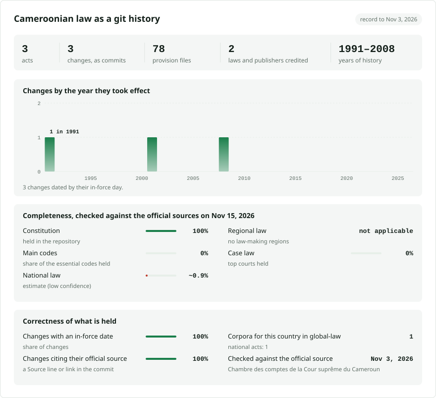

# Cameroon: law history in git

[Français](README.md) · **English**

<picture>
<source media="(prefers-color-scheme: dark)" srcset="data/effort-dark.svg">

</picture>

The law of Cameroon as a git history: one file per article (the two laws here are one file each), each version committed on the day it took effect, and the law that made each change as the commit's author. `git blame` names the law behind every paragraph; `git log` lists every change to an article; picking a date gives the text in force that day.

Part of [lexifina/global-law](https://github.com/lexifina/global-law), one git history for every country's law: this is Cameroon's national law, which global-law reads at `cameroon/national/acts/`.

**What is in it now:** three acts, one version each: the Constitution (Loi n°96/06 of 18 January 1996 revising the Constitution of 2 June 1972, as amended by Loi n°2008/001 of 14 April 2008), in force from 14 April 2008, with the preamble and 69 articles; Loi n°91/022 of 16 December 1991, rehabilitating certain figures of Cameroon's history; and Loi n°2001/016 of 23 July 2001, on the status of the Chambres consulaires. [`constitution/README.md`](constitution/README.md) lists every provision.

**Not today's text.** Loi n°2026/002 of 14 April 2026 amended the Constitution again and is not applied (see [What it does not show](#what-it-does-not-show)), so for any day after 14 April 2008 this record gives the 2008 text.

Each article of the Constitution is one file in `constitution/` (`art-006.md` is Article 6, the election and term of the President); the preamble is `preambule.md`, and [`constitution/structure.md`](constitution/structure.md) names the article each title and chapter heading precedes. Each of the two laws is one file, `texte.md`, in its own folder (`loi-91-022-rehabilitation/`, `loi-2001-016-chambres-consulaires/`), in the official page's paragraph order.

The text is in French, as its publishers print it. Cameroon publishes its laws in French and English; the English text is not part of this record.

## Questions as git commands

| Question | Command |
| --- | --- |
| Every change to Article 6 of the Constitution (the President's term) | `git log -p --word-diff -- constitution/art-006.md` |
| Which law wrote each line of Article 6? | `git blame constitution/art-006.md` |
| Every version of Article 6, with the day each took effect | `git log --format="%h %(trailers:key=In-force,valueonly,separator=) %an" -- constitution/art-006.md` |
| Article 6 as in force on 1 January 2020 | `python tools/en_vigueur_au.py 2020-01-01 constitution 6` |

**Outside git**, we also host this record publicly, for free:

- **[Ask Claude about Cameroonian law](https://global-law.lexifina.com/v1/try_claude?country=cameroon)**: opens Claude with a first question ready.
- **[Ask ChatGPT](https://global-law.lexifina.com/v1/try_chatgpt?country=cameroon)**: the same question in ChatGPT.
- **[Search Cameroonian law on our site](https://lexifina.com/law?country=cameroon&q=droit+de+gr%C3%A8ve)**: a search for "droit de grève" (the right to strike), with each provision's text and its versions, no account needed.
- **[Developer REST API](https://global-law.lexifina.com/v1/search_law?query=droit+de+gr%C3%A8ve&jurisdiction=cameroon)**: the same search as JSON, with no key. See the [documentation here](https://lexifina.com/api/global-law).

Both assistants read the record through the free Global law connector (MCP, `https://global-law.lexifina.com/mcp`); the first time, the chat gives you the link that adds it. Ask in French or in English.

**Host it yourself easily.** All it takes is git and Python, and the tools run on your machine:

```sh
git clone --depth 1 https://github.com/lexifina/global-law && cd global-law
python3 tools/countries.py add cameroon/national/acts
python3 tools/law.py show 2026-01-01 cameroon/national/acts/constitution/art-006.md
```

Opened in Claude Code, Cursor, VS Code or Codex, the clone also starts a local MCP server with the same tools ([MCP.md](https://github.com/lexifina/global-law/blob/main/MCP.md)).

## Dates

Each commit is dated at noon, Africa/Douala, on the day the version took effect, and carries it in its `In-force:` trailer:

- the Constitution: 14 April 2008, the promulgation of Loi n°2008/001, as the consolidation's title prints it;
- Loi n°91/022 and Loi n°2001/016: 16 December 1991 and 23 July 2001, the promulgation dates their texts print;
- laws are published in the Journal officiel in French and English (article 31 of the Constitution), but the Journal officiel is not openly available, so no day of publication was found.

Each first commit is credited to its publisher as the oldest version available, and names the laws that produced the text: the Chambre des comptes de la Cour suprême for the Constitution (Loi n°96/06 and Loi n°2008/001), the Présidence de la République for the two laws. The committer is always Lexifina.

## How it is checked

- `tools/check_repo.py` reads every version back from git on the day it took effect and on the day before, and both must match the corpus the history was built from; it also checks that every commit's trailers parse and that there are no merge commits.
- `tools/build.py` writes the history from that corpus in one pass; a second build into an empty folder gave identical hashes. New acts are appended on top of `main` by `tools/append.py`, which rewrites nothing. The results are in [`REPRODUCE.md`](REPRODUCE.md), and [`data/corpus.sha256`](data/corpus.sha256) gives the corpus's hash.
- The Constitution is the PDF's own text layer (the file was made with Word, not scanned), compared character by character with a second, independent extraction; the two laws' official HTML texts were read by two independent parsers, and every line matched.

## What it does not show

- **The Constitution in force today.** Loi n°2026/002 of 14 April 2026 amended it, but it is published only as a scan, and scans are not transcribed.
- **The Constitution before 2008**: the Constitution of 1972, its 1996 revision as enacted and the words Loi n°2008/001 replaced; the Presidency's copies of both laws are scans.
- **The English text**, of equal standing with the French (article 1): no official English copy with a text layer was found.
- **Most other laws.** The Presidency's official list has 213 entries (checked 2026-11-03); for most it gives only an image or a PDF, and those checked are scans, among them the Penal Code (Loi n°2016/007) and the personal data law (Loi n°2024/017).
- **Headings and marks.** Title and chapter headings are in `structure.md`, not in the article files; the consolidation's "(nouveau)" marks, which flag the provisions Loi n°2008/001 changed, and its page numbers are left out. Typos are kept as printed.

## Sources

| Source | Kind | Past versions | Notes |
| --- | --- | --- | --- |
| [Chambre des comptes de la Cour suprême](https://chambredescomptes.cm) | The consolidated French text of the Constitution, a Word PDF of 30 pages, as kept by the Internet Archive on 22 April 2024 | no, the 2008 text only | The Constitution's text and its date |
| [Présidence de la République](https://www.prc.cm/fr/actualites/actes/lois) | Official law pages: HTML texts and scanned PDFs | no, each text as published | The texts and dates of Loi n°91/022 and Loi n°2001/016, and the title and date of Loi n°2008/001; Loi n°2026/002 is a scan, not used |

## Licence

See [`LICENSE`](LICENSE). The texts are official legislative texts of the Republic of Cameroon, reproduced with attribution to the Chambre des comptes de la Cour suprême (the Constitution) and the Présidence de la République (the two laws); the publishers state no licence, and their copyright status is not confirmed here. The history, commit messages, tables and tools are CC0 1.0.

No AI model wrote, translated or corrected legal text, and none runs when the history is built; the scripts were written by an AI model (see [`REPRODUCE.md`](REPRODUCE.md)).

## More

From [lexifina/global-law](https://github.com/lexifina/global-law):

- [FEATURES.md](https://github.com/lexifina/global-law/blob/main/FEATURES.md): every feature, and what every corpus must support (`git blame`, `law.py`, the MCP tools)
- [FAQ.md](https://github.com/lexifina/global-law/blob/main/FAQ.md): questions and answers · [CONTRIBUTING.md](https://github.com/lexifina/global-law/blob/main/CONTRIBUTING.md): proposing changes · [MCP.md](https://github.com/lexifina/global-law/blob/main/MCP.md): the MCP server · [REPRODUCE.md](https://github.com/lexifina/global-law/blob/main/REPRODUCE.md): how it was built · [CHANGELOG.md](https://github.com/lexifina/global-law/blob/main/CHANGELOG.md)
- [FRESHNESS.md](https://github.com/lexifina/global-law/blob/main/FRESHNESS.md): how current each corpus is · [Monitoring](https://github.com/lexifina/global-law/tree/main/monitoring): whether updates are running · [WATCHING.md](https://github.com/lexifina/global-law/blob/main/WATCHING.md): how each official source is watched for changes
- [performance/](https://github.com/lexifina/global-law/tree/main/performance): how fast the tools are, measured
- [visualisations/](https://github.com/lexifina/global-law/tree/main/visualisations): charts and bridges across the world's law
- [Vulnerabilities](https://github.com/lexifina/global-law/tree/main/vulnerabilities): mistakes in legislation as published
