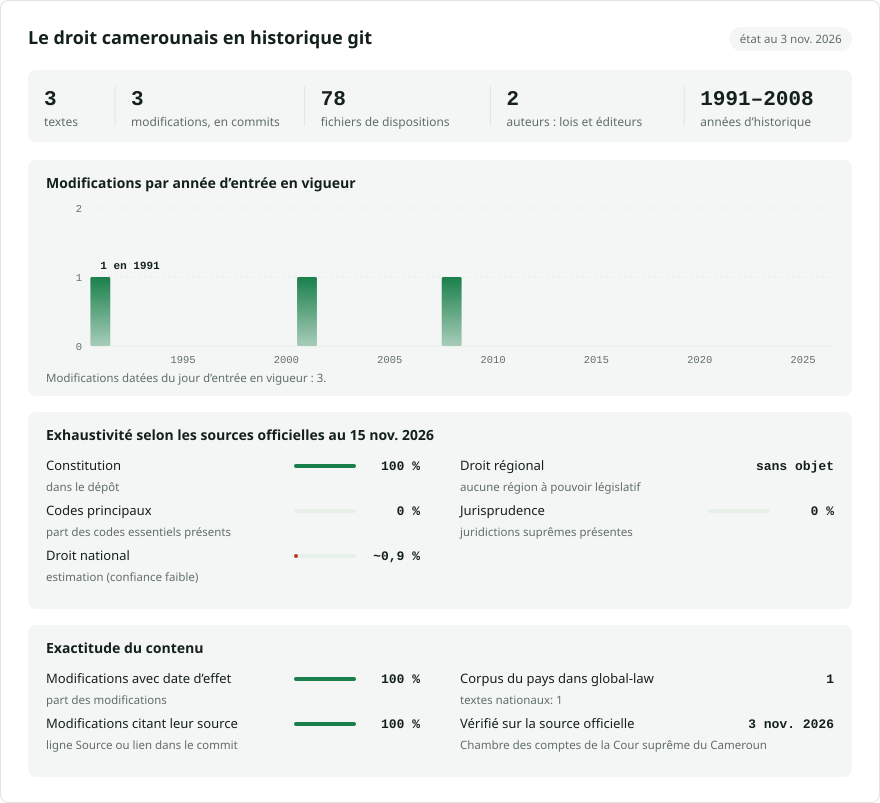

# Cameroun : l’historique du droit dans git

**Français** · [English](README.en.md)

<picture>
<source media="(prefers-color-scheme: dark)" srcset="data/fr/effort-dark.svg">

</picture>

Le droit camerounais sous forme d’historique git : un fichier par article (les deux lois présentes forment chacune un seul fichier), chaque version enregistrée au jour de son entrée en vigueur, et pour auteur de chaque commit la loi qui a apporté la modification. `git blame` désigne la loi à l’origine de chaque alinéa ; `git log` énumère toutes les modifications d’un article ; le choix d’une date donne le texte en vigueur ce jour-là.

Fait partie de [lexifina/global-law](https://github.com/lexifina/global-law), un historique git unique pour le droit de chaque pays : ce dépôt contient le droit national camerounais, que global-law lit dans `cameroon/national/acts/`.

**Contenu actuel :** trois textes, en une version chacun : la Constitution (loi n°96/06 du 18 janvier 1996 portant révision de la Constitution du 2 juin 1972, modifiée par la loi n°2008/001 du 14 avril 2008), en vigueur depuis le 14 avril 2008, avec le préambule et 69 articles ; la loi n°91/022 du 16 décembre 1991, relative à la réhabilitation de certaines figures de l’histoire du Cameroun ; et la loi n°2001/016 du 23 juillet 2001, relative au statut des Chambres consulaires. [`constitution/README.md`](constitution/README.md) énumère chaque disposition.

**Ce n’est pas le texte en vigueur aujourd’hui.** La loi n°2026/002 du 14 avril 2026 a de nouveau modifié la Constitution et n’est pas appliquée (voir [Ce qu’il ne montre pas](#ce-quil-ne-montre-pas)) ; pour tout jour postérieur au 14 avril 2008, ce registre donne donc le texte de 2008.

Chaque article de la Constitution est un fichier dans `constitution/` (`art-006.md` est l’article 6, relatif à l’élection et au mandat du Président de la République) ; le préambule est `preambule.md`, et [`constitution/structure.md`](constitution/structure.md) indique l’article que précède chaque intitulé de titre et de chapitre. Chacune des deux lois est un fichier unique, `texte.md`, dans son propre dossier (`loi-91-022-rehabilitation/`, `loi-2001-016-chambres-consulaires/`), dans l’ordre des paragraphes de la page officielle.

Le texte est en français, tel que l’impriment ses éditeurs. Le Cameroun publie ses lois en français et en anglais ; le texte anglais ne fait pas partie de ce registre.

## Questions sous forme de commandes git

| Question | Commande |
| --- | --- |
| Toutes les modifications de l’article 6 de la Constitution (le mandat du Président) | `git log -p --word-diff -- constitution/art-006.md` |
| Quelle loi a écrit chaque ligne de l’article 6 ? | `git blame constitution/art-006.md` |
| Toutes les versions de l’article 6, avec le jour d’entrée en vigueur de chacune | `git log --format="%h %(trailers:key=In-force,valueonly,separator=) %an" -- constitution/art-006.md` |
| L’article 6 tel qu’en vigueur le 1er janvier 2020 | `python tools/en_vigueur_au.py 2020-01-01 constitution 6` |

**En dehors de git**, nous hébergeons aussi ce registre publiquement, gratuitement :

- **[Interroger Claude sur le droit camerounais](https://global-law.lexifina.com/v1/try_claude?country=cameroon)** : ouvre Claude avec une première question prête.
- **[Interroger ChatGPT](https://global-law.lexifina.com/v1/try_chatgpt?country=cameroon)** : la même question dans ChatGPT.
- **[Rechercher dans le droit camerounais sur notre site](https://lexifina.com/law?country=cameroon&q=droit+de+gr%C3%A8ve)** : une recherche de « droit de grève », avec le texte de chaque disposition et ses versions, sans compte.
- **[API REST pour les développeurs](https://global-law.lexifina.com/v1/search_law?query=droit+de+gr%C3%A8ve&jurisdiction=cameroon)** : la même recherche en JSON, sans clé. Voir la [documentation ici](https://lexifina.com/api/global-law).

Les deux assistants lisent le registre au moyen du connecteur gratuit Global law (MCP, `https://global-law.lexifina.com/mcp`) ; la première fois, la conversation vous donne le lien qui l’ajoute. Posez vos questions en français ou en anglais.

**L’héberger vous-même, simplement.** Il suffit de git et de Python, et les outils s’exécutent sur votre machine :

```sh
git clone --depth 1 https://github.com/lexifina/global-law && cd global-law
python3 tools/countries.py add cameroon/national/acts
python3 tools/law.py show 2026-01-01 cameroon/national/acts/constitution/art-006.md
```

Ouvert dans Claude Code, Cursor, VS Code ou Codex, le clone lance aussi un serveur MCP local doté des mêmes outils ([MCP.md](https://github.com/lexifina/global-law/blob/main/MCP.md)).

## Dates

Chaque commit est daté à midi, heure de Douala (Africa/Douala), du jour où la version est entrée en vigueur, et porte ce jour dans son trailer `In-force:` :

- la Constitution : le 14 avril 2008, date de promulgation de la loi n°2008/001, telle que l’indique le titre de la version consolidée ;
- la loi n°91/022 et la loi n°2001/016 : le 16 décembre 1991 et le 23 juillet 2001, dates de promulgation qu’indiquent leurs textes ;
- les lois sont publiées au Journal officiel en français et en anglais (article 31 de la Constitution), mais le Journal officiel n’est pas librement accessible ; aucune date de publication n’a donc été trouvée.

Chaque premier commit est attribué à son éditeur en tant que plus ancienne version disponible, et nomme les lois dont le texte est issu : la Chambre des comptes de la Cour suprême pour la Constitution (loi n°96/06 et loi n°2008/001), la Présidence de la République pour les deux lois. Le committer est toujours Lexifina.

## Comment il est vérifié

- `tools/check_repo.py` relit chaque version depuis git au jour de son entrée en vigueur et la veille, et les deux doivent correspondre au corpus à partir duquel l’historique a été construit ; il vérifie aussi que les trailers de chaque commit se lisent sans erreur et qu’il n’existe aucun commit de fusion.
- `tools/build.py` écrit l’historique à partir de ce corpus en une seule passe ; une seconde construction dans un dossier vide a donné des empreintes identiques. Les nouveaux textes sont ajoutés au-dessus de `main` par `tools/append.py`, qui ne réécrit rien. Les résultats figurent dans [`REPRODUCE.md`](REPRODUCE.md), et [`data/corpus.sha256`](data/corpus.sha256) donne l’empreinte du corpus.
- La Constitution est la couche texte propre au PDF (le fichier a été produit avec Word, et non numérisé), comparée caractère par caractère avec une seconde extraction indépendante ; les textes HTML officiels des deux lois ont été lus par deux analyseurs indépendants, et chaque ligne concordait.
- [vulnerabilities/](vulnerabilities/): erreurs de rédaction possibles dans ce droit, trouvées par les détecteurs de global-law et vérifiées à la main. Pas encore lancé.

## Ce qu’il ne montre pas

- **La Constitution en vigueur aujourd’hui.** La loi n°2026/002 du 14 avril 2026 l’a modifiée, mais elle n’est publiée que sous forme de numérisation, et les numérisations ne sont pas transcrites.
- **La Constitution avant 2008** : la Constitution de 1972, sa révision de 1996 telle qu’adoptée et les termes que la loi n°2008/001 a remplacés ; les exemplaires des deux lois tenus par la Présidence sont des numérisations.
- **Le texte anglais**, qui fait foi au même titre que le texte français (article 1er) : aucun exemplaire anglais officiel doté d’une couche texte n’a été trouvé.
- **La plupart des autres lois.** La liste officielle de la Présidence compte 213 entrées (vérifiée le 3 novembre 2026) ; pour la plupart, elle ne donne qu’une image ou un PDF, et ceux qui ont été vérifiés sont des numérisations, parmi lesquelles le Code pénal (loi n°2016/007) et la loi sur les données à caractère personnel (loi n°2024/017).
- **Les intitulés et les mentions.** Les intitulés de titres et de chapitres figurent dans `structure.md`, et non dans les fichiers des articles ; les mentions « (nouveau) » de la version consolidée, qui signalent les dispositions modifiées par la loi n°2008/001, ainsi que ses numéros de page, sont omis. Les coquilles sont conservées telles qu’imprimées.

## Sources

| Source | Nature | Versions antérieures | Remarques |
| --- | --- | --- | --- |
| [Chambre des comptes de la Cour suprême](https://chambredescomptes.cm) | Le texte français consolidé de la Constitution, un PDF Word de 30 pages, tel que conservé par l’Internet Archive le 22 avril 2024 | non, le seul texte de 2008 | Le texte de la Constitution et sa date |
| [Présidence de la République](https://www.prc.cm/fr/actualites/actes/lois) | Pages officielles des lois : textes HTML et PDF numérisés | non, chaque texte tel que publié | Les textes et les dates de la loi n°91/022 et de la loi n°2001/016, ainsi que le titre et la date de la loi n°2008/001 ; la loi n°2026/002 est une numérisation, non utilisée |

## Licence

Voir [`LICENSE`](LICENSE). Les textes sont des textes législatifs officiels de la République du Cameroun, reproduits avec mention de la Chambre des comptes de la Cour suprême (la Constitution) et de la Présidence de la République (les deux lois) comme source ; les éditeurs n’indiquent aucune licence, et le statut de ces textes au regard du droit d’auteur n’est pas confirmé ici. L’historique, les messages de commit, les tableaux et les outils sont sous CC0 1.0.

Aucun modèle d’IA n’a écrit, traduit ou corrigé de texte juridique, et aucun n’est exécuté lors de la construction de l’historique ; les scripts ont été écrits par un modèle d’IA (voir [`REPRODUCE.md`](REPRODUCE.md)).

Ceci est une traduction de la version anglaise ([README.en.md](README.en.md)) ; en cas de divergence, la version anglaise fait foi.

## Visualisations

- [visualisations/](visualisations/): graphiques tirés de ce dépôt. Pas encore dessinés.

## En savoir plus

Dans le dépôt [lexifina/global-law](https://github.com/lexifina/global-law) (pages en anglais) :

- [FEATURES.md](https://github.com/lexifina/global-law/blob/main/FEATURES.md): toutes les fonctionnalités et ce que chaque corpus doit prendre en charge (`git blame`, `law.py`, outils MCP)
- [FAQ.md](https://github.com/lexifina/global-law/blob/main/FAQ.md): questions et réponses · [CONTRIBUTING.md](https://github.com/lexifina/global-law/blob/main/CONTRIBUTING.md): proposer une modification · [MCP.md](https://github.com/lexifina/global-law/blob/main/MCP.md): serveur MCP · [REPRODUCE.md](https://github.com/lexifina/global-law/blob/main/REPRODUCE.md): comment il a été construit · [CHANGELOG.md](https://github.com/lexifina/global-law/blob/main/CHANGELOG.md)
- [FRESHNESS.md](https://github.com/lexifina/global-law/blob/main/FRESHNESS.md): à quel point chaque corpus est à jour · [Surveillance](https://github.com/lexifina/global-law/tree/main/monitoring): si les mises à jour fonctionnent · [WATCHING.md](https://github.com/lexifina/global-law/blob/main/WATCHING.md): comment chaque source officielle est surveillée pour repérer les modifications
- [performance/](https://github.com/lexifina/global-law/tree/main/performance): la rapidité des outils, mesurée
- [visualisations/](https://github.com/lexifina/global-law/tree/main/visualisations): graphiques et liens à travers le droit du monde entier
- [Vulnérabilités](https://github.com/lexifina/global-law/tree/main/vulnerabilities): erreurs dans les textes tels qu’ils ont été publiés
